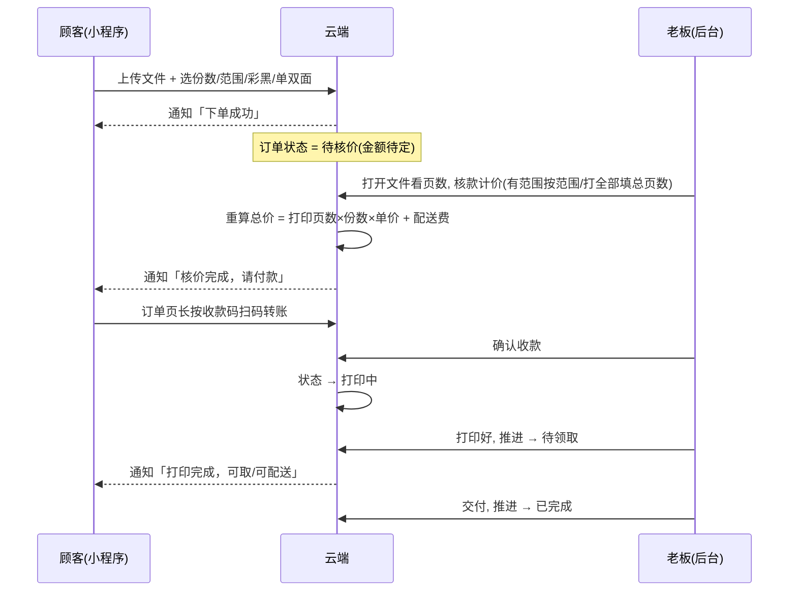

# milo 打印小店 · 产品需求文档（PRD）

> **这份文档给谁看**：打印店老板 / 非技术的产品相关人。它不讲代码，只讲「这个产品是干嘛的、给谁用、要能做什么、怎么流转」。
> 配套文档：开发部署看 [`README.md`](./README.md)，一步一步操作看 [`使用说明.md`](./使用说明.md)。

---

## 1. 产品背景与定位

**痛点**：校园打印店原来靠微信私聊接单——学生发文件、老板逐个问「几页、彩还是黑、单双面、配送吗」，再手动报价、对账。单子一多就乱，容易漏单、报错价。

**我们的方案**：做一个**微信小程序 + 网页后台**的自助打印接单系统。
- 学生**自助下单**（上传文件、选打印方式），不用和老板反复聊。
- 老板在后台**统一核价、收款、推进订单**，一目了然。

**定位**：轻量、低成本（用微信云开发，不买服务器）、贴合校园打印场景。

---

## 2. 目标用户与使用场景

| 用户 | 典型场景 |
|------|----------|
| **学生（顾客）** | 在宿舍用手机上传课件 PDF，选「打 2-10 页、1 份、黑白单面」，下单后去上课；下午收到「可取」通知，去店里拿走。 |
| **打印店老板** | 在电脑网页后台看到新订单响铃，打开文件核一下页数，点「核款计价」，等学生扫码付款后打印、交付。 |

**边界**：
- 收款方式 = 顾客**扫码转老板微信**（个人收款码），不是微信商户支付。
- 仅服务单一店铺（一个老板），不做平台化、不做多店加盟。

---

## 3. 用户故事

**顾客侧**
- 作为学生，我想上传文件并选好打印方式，这样不用和老板私聊描述需求。
- 作为学生，我想填「份数」和「打印范围」（比如只打某几页），这样更省纸省钱。
- 作为学生，我想下单后收到微信通知（下单成功 / 可以付款了 / 可以取了 / 取消了），这样不用一直刷新。
- 作为学生，我想在订单页看到收款码并长按识别付款，这样付款方便。

**老板侧**
- 作为老板，我想在后台看到所有订单和每个文件的份数/范围/页数，这样核价有据可依。
- 作为老板，我想「核款计价」一键算出总价（有范围按范围、打全部我填总页数），不用心算。
- 作为老板，我想一键把文件在电脑上用 WPS 打开，这样不用手动找文件。
- 作为老板，我想确认收款、推进订单状态、取消订单，这样流程闭环。
- 作为老板，我想新订单来时响铃提醒，这样不漏单。

---

## 4. 功能需求清单

### P0（必须有，已上线）
| 编号 | 功能 | 说明 |
|------|------|------|
| F1 | 顾客上传文件 | 支持 PDF / Word / 图片 |
| F2 | 选份数 + 打印范围 | 份数默认 1（可加减）；范围如 `2-10`，留空=全部 |
| F3 | 选彩色/黑白、单面/双面 | 基础打印选项 |
| F4 | 选配送 / 自取 | 配送需填楼栋+手机号 |
| F5 | 顾客下单 | 下单后进入「待核价」 |
| F6 | 老板核款计价 | 范围优先：有范围按范围算；打全部老板填总页数 |
| F7 | 订单状态流转 | 待核价 → 打印中 → 待领取 → 已完成；可取消 |
| F8 | 顾客扫码付款 | 订单页收款码（qrcode0.png）长按识别 |
| F9 | 老板确认收款 | 核款/收款后推进状态 |
| F10 | 双后台 | 小程序「管理」页 + 电脑网页后台，功能一致 |

### P1（重要，已上线）
| 编号 | 功能 | 说明 |
|------|------|------|
| F11 | 微信订阅通知 ×4 | 下单 / 核价成功待支付 / 打印完成可取 / 取消 |
| F12 | 网页后台新订单响铃 + 桌面通知 | 每 30 秒轮询 |
| F13 | 一键打开文件进 WPS | 需打印电脑开本地助手（print-helper） |
| F14 | PDF 页数自动识别 | 上传后服务端数页（pdf-lib） |
| F15 | 价格实时预览 | 顾客端按「打印页数×份数×单价」预览，最终以核价为准 |
| F20 | 营业状态开关 | 网页后台切换休息/营业（写入云端）；休息中小程序禁止下单并显示横幅 |
| F21 | 转账备注对账 | 学生端提示「转账备注订单号后6位」；后台待收款卡片显示金额+备注号，便于个人码收款对账 |
| F22 | 流程时序守卫 | 服务端强制：未核价不能确认收款、未确认收款不能开印 |
| F23 | 批量一键核价 | 网页后台对页数齐全（有范围/已知页数）的待核价订单一键核价并批量下发付款通知 |
| F24 | 顾客微信身份 | 首页设置头像昵称（微信官方填写能力）；订单冗余存昵称/头像，后台显示「头像+昵称」，自取订单靠昵称认人 |
| F26 | 核价纠正选项 | 核款计价弹窗内每文件可切换黑白/彩色、单面/双面并实时重算，服务端按纠正后选项计价 |

### P2（锦上添花，待做）
| 编号 | 功能 | 说明 |
|------|------|------|
| F16 | 订单筛选 / 搜索 | 网页后台按状态筛选、按订单号搜 |
| F17 | 今日营业额统计 | 网页后台汇总 |
| F18 | 静默打印 | 网页后台一键直接送打印机（需配置打印机） |
| F19 | 顾客历史订单 / 复打 | 一键重下过往订单 |

---

## 5. 核心业务流程

---

## 6. 价格规则

**总价 = Σ(每个文件：实际打印页数 × 份数 × 单价) + 配送费**

- **单价**（每页/每张）：黑白单面 ¥0.25、彩色单面 ¥0.50；双面按「每 2 页 1 张」计（黑白 ¥0.40/张、彩色 ¥0.80/张），多出的 1 页按单页算。
- **份数**：顾客填，默认 1，最小 1。
- **打印页数**：顾客填了范围就按范围算（如 `2-10` = 9 页）；没填范围（打全部）按老板核款时填的「总页数」。
- **配送费**：合计满 ¥10 免运费，不满 ¥1；自取 0。

> 顾客端预览价仅供参考；**最终价以老板核款后写入的为准**（防止顾客篡改）。

---

## 7. 通知设计

微信订阅消息**只能发文字、不能带图片/二维码**，所以「收款码」用「点通知跳订单页 → 页面长按识别」实现。

| 事件 | 模板环境变量 | 触发时机 |
|------|--------------|----------|
| 下单成功 | `SUBSCRIBE_TEMPLATE_ID_ORDER` | 顾客提交订单后 |
| 核价完成·待支付 | `SUBSCRIBE_TEMPLATE_ID_PRICE` | 老板核款清「待核价」后 |
| 打印完成·可取 | `SUBSCRIBE_TEMPLATE_ID`（原有） | 状态推进到「待领取」 |
| 订单取消 | `SUBSCRIBE_TEMPLATE_ID_CANCEL` | 订单取消后 |

- 4 个模板字段统一：`character_string1`（订单号后6位）/ `thing2`（一句话）/ `time3`（时间）。
- **降级策略**：任一模板 ID 没配置，对应通知自动跳过，不影响下单与状态流转。
- **授权前提**：顾客下单时需点「允许」订阅，微信才允许下发；否则收不到。

---

## 8. 后台管理（两套，功能一致）

**入口**
- 小程序内「管理」页（手机）
- 电脑浏览器打开 `admin-web/index.html`（需配置 HTTP 触发器地址 + 暗号登录）

**能力**
- 订单卡片列表，带状态徽标（待核价 / 打印中 / 待领取 / 已完成 / 已取消）与「下一步」徽标（去核价 / 待收款 / 可开印 / 待交付）
- 每张订单显示**下单人微信头像昵称**（自取订单认人，老订单回退 openid）
- 每个文件显示：份数、打印范围、页数（或「待核价」）、单价
- 核款计价：填范围（有范围即按范围）或填总页数（打全部时）；页数齐全的订单可批量一键核价
- 文件操作：一键打开（进 WPS）/ PDF 预览（打印为新标签页打开）
- 订单操作：确认收款 / 推进状态 / 取消（未核价不能收款、未收款不能开印，服务端强制）
- 对账辅助：待收款卡片显示「应收金额 + 学生转账备注号」
- 营业状态：休息中时小程序端禁止下单
- 辅助：配送地址+备注高亮、新订单响铃+桌面通知（网页端每 30 秒轮询并全量同步别端操作）、今日营业额（按完成时间）与待收款合计

---

## 9. 非功能需求

- **可用性**：云开发托管，无需自建服务器；断网时本地助手的一键打开降级为「下载文件」。
- **安全**：订单操作（确认收款/取消/核款）服务端校验管理员身份；网页后台靠 `ADMIN_SECRET_KEY` 暗号 + 不暴露敏感逻辑；暗号连续错误 10 次锁定 10 分钟防爆破。
- **性能**：PDF 数页有 20 秒超时保护，超时则转人工核价，不卡下单。
- **可降级**：通知、本地助手、网页后台任一不可用，核心下单-核价-收款流程仍可跑。

---

## 10. 已知限制与待办

- **收款是个人码**：顾客扫码转老板微信，老板需手动在微信里核对谁付的（按金额+备注/订单号）。后续可接微信支付商户实现自动对账（P2）。
- **Word/图片页数需老板核**：手机端页数不准，老板在电脑打开看实际页数填「总页数」。PDF 可自动识别。
- **死代码**：`cloudfunctions/parseDocxPreview/` 已废弃，可删。
- **网页后台增强**（P2）：筛选、搜索、营业额统计、静默打印。
- **详细部署步骤**：见 [`README.md`](./README.md) 第七节；**图文操作**：见 [`使用说明.md`](./使用说明.md)。
