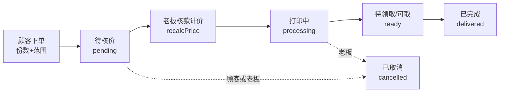

# milo 打印小店（微信小程序）

> **一句话看懂**：学生用微信小程序上传文件、选好怎么打印、下单；老板在手机小程序或电脑网页后台里「核价 → 确认收款 → 推进订单」。钱是学生扫码直接转给老板的微信（个人收款码，不是微信商户支付）。

---

## 一、这是什么（给小白看）

| 角色 | 是谁 | 用什么 | 干啥 |
|------|------|--------|------|
| 顾客 | 校园里要打印的学生 | 微信小程序（顾客端） | 上传文件、选份数/范围、下单、看通知、扫码付款 |
| 老板 | 打印店老板 | 小程序「管理」页 **或** 电脑网页后台 | 核价、确认收款、推进订单状态、一键打开文件 |

**解决什么痛点**：原来靠微信私聊传文件、逐个回复「几页、彩还是黑、单双面」，又慢又乱。现在学生自助下单，老板后台一条条处理。

**钱怎么收**：顾客下单后**不立刻付钱**。等老板核完价，顾客会收到「核价完成，请付款」通知 → 点进去看到老板的**微信收款码** → 长按识别扫码转账。老板在后台点「确认收款」即可。

---

## 二、主要功能

### 顾客端（小程序首页 / 我的订单）
- 首页可设置**头像和昵称**（微信官方「头像昵称填写能力」，一键用微信头像昵称）——自取订单老板靠昵称认人，没设就自取下单会提醒一次
- 上传文件：PDF、Word、PPT、图片都行
- **选「份数」**（默认 1 份，可加减）和**「打印范围」**（如 `2-10`，留空 = 打全部）
- 选彩色/黑白、单面/双面
- 选配送（填楼栋+手机号）或自取
- 下单后：填了范围 → 显示「待老板核价」；核完价 → 订单页显示总价 + 收款码（长按识别）
- 收到微信通知：下单成功 / 核价完成请付款 / 打印完成可取 / 订单取消

### 老板端（两套后台，功能一样）
1. **小程序「管理」页**（手机上）
2. **电脑网页后台** `admin-web/index.html`（浏览器打开，用「暗号」登录）

老板能做的：
- 看每张订单、每个文件（份数、范围、页数、单价）+ **下单人微信头像昵称**（自取订单认人）
- **核款计价**：顾客填了范围就直接按范围算价；顾客没填范围（打全部）才需要老板填「总页数」；页数齐全的单子可**批量一键核价**；核价时可顺手**纠正彩黑/单双面**（学生常选错，点开关即改、实时重算）
- **一键打开文件**进 WPS（需打印电脑开着本地助手，见下文）
- **确认收款 / 推进状态 / 取消订单**（未核价不能确认收款、未确认收款不能开印，服务端强制）
- 新订单来时网页会**响铃 + 弹桌面通知**；别端操作（手机管理页确认收款、学生取消）30 秒内自动同步
- **营业状态开关**：切到「休息中」，小程序端立刻显示休息横幅并禁止下单（真实生效，写入云端）
- **对账辅助**：待收款订单显示「应收金额 + 学生转账备注号」，学生端付款时也会提示备注订单号后 6 位

---

## 三、价格怎么算（老板核价就按这个）

> **公式：总价 = 每个文件的（实际打印页数 × 份数 × 单价）之和 + 配送费**

**单价表**

| 类型 | 单面 | 双面 |
|------|------|------|
| 黑白 | ¥0.25 / 页 | ¥0.40 / 张（每 2 页算 1 张，多出的 1 页按单页 ¥0.25） |
| 彩色 | ¥0.50 / 页 | ¥0.80 / 张（每 2 页算 1 张，多出的 1 页按单页 ¥0.50） |

**配送费**：订单合计满 ¥10 免运费，不满收 ¥1；自取免费。

**举几个例子**
- 黑白单面、3 页、1 份 → 3 × 0.25 = **¥0.75**
- 黑白单面、3 页、2 份 → 3 × 0.25 × 2 = **¥1.50**
- 彩色双面、26 页、1 份 → 13 张 × 0.80 = **¥10.40**（26 页刚好 13 张，无剩余单页）
- 黑白单面、26 页、3 份 → 26 × 0.25 × 3 = **¥19.50**

> 顾客端会**实时预览**价格；但最终价格以老板**核款后**为准（防止顾客乱改）。

---

## 四、一个订单的一生



- 顾客下单 → 状态 **待核价**（金额还没定，因为 PDF 自动识别、Word/图片要老板看实际页数）
- 老板核款 → 算出总价 → 顾客收到「请付款」通知
- 顾客扫码转账 → 老板点「确认收款」→ 状态变 **打印中**
- 打印好 → 老板推进到 **待领取**（顾客收到「可取/可配送」通知）
- 取走/送达 → **已完成**
- 取消规则：顾客只能取消「待核价**且未确认收款**」的单子；一旦确认收款，取消须联系店家由老板操作（防止钱已到账、单被单方取消）

---

## 五、技术栈（了解即可，不用深究）

- **小程序**：微信原生框架（WXML / WXSS / JS）
- **后端**：微信云开发 = 云函数 + 云数据库 + 云存储（不用自己买服务器）
- **网页后台**：单个 HTML 文件（Tailwind CSS + 原生 JS），靠云函数的 HTTP 接口工作
- **本地助手**：打印电脑上跑一个 Node 小程序 `print-helper`，负责把云文件下载下来并用 WPS 打开

---

## 六、项目结构

```
milo-打印小店-小程序/
├── app.js / app.json / app.wxss        # 小程序入口与全局配置
├── pages/
│   ├── home/                           # 顾客端：上传、选份数/范围、下单
│   ├── orders/                         # 顾客端：我的订单（含收款码、长按识别）
│   └── admin/                          # 老板端：小程序里的「管理」页
├── custom-tab-bar/                     # 底部导航栏（首页/订单/管理）
├── cloudfunctions/                     # 云端跑的后台程序（9 个）
│   ├── login/                          # 登录 + 拿到用户身份
│   ├── getUserProfile/                 # 查/建用户资料
│   ├── createOrder/                    # 下单（服务端权威计价，PDF 自动数页）
│   ├── parsePdfPreview/                # 上传后异步解析 PDF 页数
│   ├── updateOrder/                    # 订单操作门卫：确认收款/推进/取消/核款（事务化）
│   ├── setAdmin/                       # 把自己设成管理员（用暗号）
│   ├── adminApi/                       # 网页后台专用的接口（同样要暗号）
│   ├── getShopStatus/                  # 查营业状态（小程序首页用，休息中禁止下单）
│   └── cleanupStorage/                 # 每日定时清理没下单的孤儿文件（依 pendingFiles 台账）
├── admin-web/
│   └── index.html                      # 电脑网页后台
├── print-helper/                       # 打印电脑本地助手（一键打开文件进 WPS）
├── images/                             # 图标 + 收款二维码（qrcode0.png）
├── generate-icons.js                   # 生成图标的脚本（不含二维码）
└── 使用说明.md / PRD.md                # 给人和给需求看的文档
```

> 计价/范围解析逻辑在 createOrder、updateOrder、adminApi、pages/home/home.js 四处各有一份（云函数独立部署所需）。**改价目表后务必跑 `node test/pricing.test.js`**，它会核对四处实现与 README 算例是否一致。

---

## 七、怎么部署（一步一步，给第一次上手的人）

### 1. 装微信开发者工具
下载 https://developers.weixin.qq.com/miniprogram/dev/devtools/download.html ，用微信扫码登录。

### 2. 导入项目
- 「导入项目」→ 目录选你克隆下来的本项目文件夹
- AppID：填**你自己**的小程序 AppID（还没有的话可先用测试号 `touristappid`）
- 后端服务：**选「微信云开发」**

### 3. 开通云开发
点左上角「云开发」→ 开通 → 记住控制台显示的**环境 ID**（形如 `cloud1-xxxxxx`），等它建好，然后把 `app.js` 顶部的 `env` 改成它。

### 4. 建数据库集合
云开发控制台 → 数据库 → 新建集合：`users`、`orders`、`settings`、`pendingFiles`。`users`、`orders`、`pendingFiles` 权限设成「**仅创建者可读写**」；`settings`（营业状态）只由云函数读写，权限也建议设「**仅创建者可读写**」——不要开「所有人可读写」，否则任何用户都能把你的店切成休息中。
云存储建议在「存储 → 权限设置」改为「**仅创建者可读写**」：学生上传的文件可能含隐私内容，默认「所有用户可读」意味着拿到 fileID 的人都能下载；后台预览/打印走云函数临时链接，不受此限制。

### 5. 部署云函数（关键）
在左侧 `cloudfunctions` 目录，**逐个**右键 → 「上传并部署：云端安装依赖」：
- `login`、`getUserProfile`、`createOrder`、`parsePdfPreview`、`updateOrder`、`setAdmin`、`adminApi`、`getShopStatus`、`cleanupStorage`
- 其中 `createOrder` 用到了 pdf-lib（数 PDF 页数），部署后记得把它的**超时调到 20 秒**（云函数配置里）。
- `cleanupStorage` 自带每日 04:30 定时触发器（随部署生效），自动删除「超过 7 天且不在任何订单中」的孤儿文件，无需手动配置。

### 6. 设自己为管理员
部署好 `setAdmin` 后，去云开发控制台 → `setAdmin` 云函数 → 配置**环境变量** `ADMIN_SECRET_KEY` = 你自定的一个强随机暗号（别用示例值）。然后调一次 `setAdmin`（或用小程序首页触发）把自己设成 admin。

### 7. 放收款码
把你的**微信收款二维码**图片替换 `images/qrcode0.png` **和** `images/qrcode1.png`（两张都得是有效收款码：首页支付弹窗和订单页会随机展示其中一张）。**注意：这两个文件别被图标生成脚本覆盖**。

> 🔒 三张收款码图（含历史备份 `qrcode.png`）含个人收款信息，**已加入 `.gitignore`，不随 git 仓库分发**；本地文件保留、小程序打包不受影响。换电脑克隆本仓库后需手动把三张图放回 `images/`。

### 8. 微信通知（已配置好）
4 个订阅消息模板已在微信公众平台选用，模板 ID **直接写在了三个云函数代码顶部**（环境变量仍可覆盖，但不需要配）：

| 用途 | 模板 | 所在函数 |
|------|------|----------|
| 下单成功 | 备忘录任务提醒 | `createOrder` |
| 核价完成·待付款 | 审核结果通知 | `updateOrder` / `adminApi` |
| 打印完成·可取 | 会议通知 | `updateOrder` / `adminApi` |
| 订单取消 | 行程提醒 | `updateOrder` / `adminApi` |

每个模板的字段编号已按实际值适配（各不相同，见云函数内注释）。**重新部署这三个云函数即可生效**，不部署则通知静默跳过、不影响下单。

### 9. 网页后台怎么用
1. 部署 `adminApi`，并在它环境变量加 `ADMIN_SECRET_KEY`（同上暗号）
2. `adminApi` 详情 → **触发器** → 开 HTTP 触发，复制那个 `https://环境ID.service.tcloudbase.com/adminApi` 地址
3. 打开 `admin-web/index.html`，把顶部 `CONFIG.cloudFuncUrl` 填成第 2 步地址
4. 浏览器打开这个 HTML，输暗号登录即可
5. 想要「一键打开」自动弹 WPS：打印电脑上 `node print-helper/helper.js` 常驻运行（详见 `print-helper/README` 或运行目录里的说明）

### 10. 预览体验
微信开发者工具点「预览」→ 手机扫码打开小程序。

---

## 八、常见问题 / 注意事项

- **收款码文件**：首页支付弹窗与订单页从 `images/qrcode0.png`、`images/qrcode1.png` 中**随机展示一张，两张都必须是有效收款码**。`images/qrcode.png` 是历史备份，已无代码引用。学生付款时页面会提示「转账备注订单号后 6 位」，老板按金额 + 备注号与微信收款流水对账。
- **通知收不到**：先确认 4 个模板 ID 已申请并填进环境变量；且顾客下单时点了「允许」订阅（微信要求用户主动授权才发得出）。
- **PDF 页数为什么有时不准**：手机端只是预览，最终以老板在电脑打开文件看到的页数为准（老板核款时填「总页数」）。
- **微信订阅消息不能带图片**：所以收款码是用「点通知跳订单页 → 页面上长按识别」的方式给顾客，而不是把二维码塞进通知里。
- **死代码**：`cloudfunctions/parseDocxPreview/` 已删除（Word 自动数页功能下线后遗留，2026-08 清理）。
- **清理 `print-files/pending/` 目录**：顾客下单时文件会自动从 pending/ 挪到 `print-files/order/`，订单不再引用 pending/ 目录；剩下的都是「传了但没下单」的预览残留，由 `cleanupStorage` 云函数**每日自动清理**（依据 `pendingFiles` 台账，只删「超过 7 天 且 fileID 不在任何订单里」的文件，另有订单引用保护兜底）。台账上线前的存量孤儿文件仍需按老规则手动清一次。
- **已收款的订单顾客不能自行取消**：顾客取消仅限「待核价且未确认收款」的单子；确认收款后如需取消须顾客联系店家，由老板在后台操作（避免钱已到账、单被单方取消的扯皮）。
- **更详细的操作图文**：见 `使用说明.md`；**产品需求/功能清单**：见 `PRD.md`。

---

## License

[MIT](LICENSE) —— 可自由使用、修改、商用，只需保留原版权声明。
